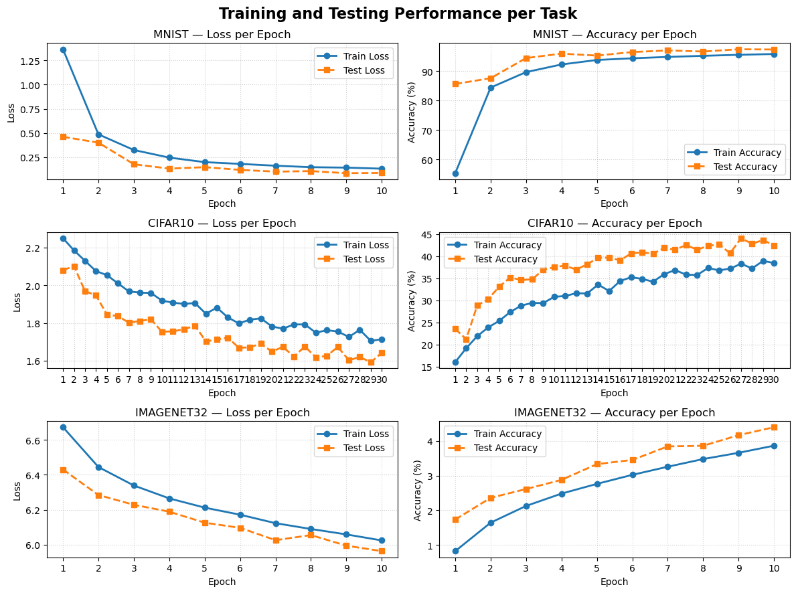
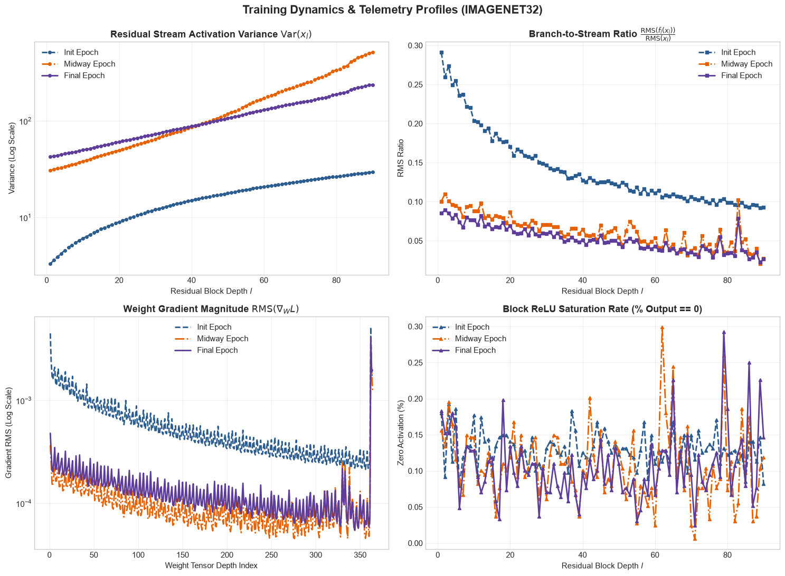
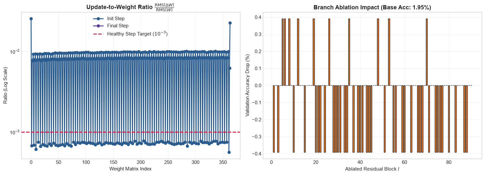

# Final Report - AI5200 Project 1 - Clay Chambers


## 1. Final models.
**For each task, describe your final architecture and training recipe: depth, width, activation, normalization, optimizer, schedule, regularization, augmentation, and training time. A table works well here. Report test accuracy from the harness next to the baseline's.**

### MNIST

| MNIST Final Model| |
| :--- | :--- |
| Depth | 30 |
| Width | 128 |
| Activation | SwiGLU |
| Normalization | LayerNorm at beginning of block|
| Optimizer | AdamW, lr=0.001, weight_decay=0.05 |
| Schedule | CosineAnnealingLR, 15 epochs |
| Regularlization | standardization during augmentation |
| Augmentation | RandomResizedCrop, <br> RandomRotation |
| Training Time | 1.2 minutes |
| Baseline Accuracy | 95.06% |
| Test Accuracy | 98.94% |

### CIFAR10

| CIFAR10 Final Model| |
| :--- | :--- |
| Depth | 30 |
| Width | 128 |
| Activation | SwiGLU |
| Normalization | LayerNorm at beginning of block|
| Optimizer | AdamW, lr=0.001, weight_decay=0.05 |
| Schedule | CosineAnnealingLR, 30 epochs |
| Regularlization | standardization during augmentation |
| Augmentation | AutoAugment policy=CIFAR10, <br> RandomHorizontalFlip, <br> v2.Normalization mean=0.5, std=0.25|
| Training Time | 5.1 minutes |
| Baseline Accuracy | 48.61% |
| Test Accuracy | 58.83% |

### IMAGENET32

| IMAGENET32 Final Model| |
| :--- | :--- |
| Depth | 120 |
| Width | 128 |
| Activation | SwiGLU |
| Normalization | LayerNorm at beginning of block|
| Optimizer | AdamW, lr=0.001, weight_decay=0.05 |
| Schedule | CosineAnnealingLR, 30 epochs |
| Regularlization | standardization during augmentation |
| Augmentation | AutoAugment policy=IMAGENET, <br> RandomHorizontalFlip, <br> v2.Normalization mean=0.5, std=0.25|
| Training Time | 42.2 minutes |
| Baseline Accuracy | 6.77% |
| Test Accuracy | 10.24% |


### 2. What mattered most.
**Which three to five changes improved accuracy the most? Support each claim with entries from your
log that show the change and its effect.**

#### 1. Detecting and Correcting Overfitting with cifar10 - change 13
By far, the most important change I made was in Change 13 when I added accuracy and loss curves to
my notebook. Up to then, I was almost exclusively watching the training loss and test accuracy but
not understanding why accuracy was stagnant while loss dropped near zero. Once I added a
visualization, it allowed me to have a eureka moment and finally start understanding that the
networks were memorizing inputs rather than actually learning.


## change 15



#### 2. Data Augmentation - changes 14-16

Apart from addressing overfitting in general, data augmentation seemed to have the biggest impact on
model accuracy. In Change 14, I began experimenting with different augmentation techniques. I realy
wanted RandomAffine to work and spent several changes toying with it. Changes #14 - 16 were focued
nearly entirely on augmentation.


    #### **CIFAR10 Mini Study**
    When experimenting with Data Augmentation, I ran through many, many combinations of pytorch v2 transforms with various parameters. I spent a little time building a demo notebook so I could visualize what the transforms were actually doing. It's in my repo. Here's what I learned.

    First, I saw published means and standard deviations for imagenet32 on the [documentation page for pytorch](https://docs.pytorch.org/vision/0.29/transforms.html). So, I looked up published values for cifar10 and found them. However, those values are derived from the whole dataset. In a real-world scenario, we wouldn't know the inference values in advance, so I'm not planning to use them in my real model beyond this initial mini study.

    **Published means and std devs**
        cifar10_mean = [0.4914, 0.4822, 0.4465]
        cifar10_std  = [0.2470, 0.2435, 0.2616]

    | Normalizations | Loss<br>after 10 epochs | Train Accuracy<br>after 10 epochs | Test Accuracy<br>after 10 epochs |
    | :--- | :--- | :--- | :--- |
    | None (pixel values 0.0 - 1.0)  | 1.36 | 51.06 | 48.50 |
    | v2.Normalize m = 0.5, std = 0.25         | 0.39 | 86.38 | 50.21 |
    | v2.Normalize m = 0.5, std = 0.50         | 0.49 | 82.73 | 49.51 |
    | v2.Normalize m = published, std = published   | 0.35 | 87.43 | 49.61 |


    **Combine v2.Normalize with other augmentations**
    | Normalized <br>plus other<br>transforms | Loss<br>after 10 epochs | Train Accuracy<br>after 10 epochs | Test Accuracy<br>after 10 epochs |
    | :--- | :--- | :--- | :--- |
    | v2.AutoAugment  | 1.51 | 46.76 | 48.93 |
    | v2.RandomHorizontalFlip         | 0.75 | 73.74 | 51.65 |
    | v2.RandomAffine         | 1.46 | 47.48 | 46.56 |
    | v2.RandomResizeCrop   | 1.62 | 41.82 | 48.53 |
    | v2.RandomResizeCrop<br>and RandomHorizontalFlip   | 1.64 | 40.71 | 47.96 |
    | v2.AutoAugment<br>and RandomHorizontalFlip   | 1.52 | 43.58 | 51.18 |


    *_Label: CIFAR-10 Mini Study_*

    *Conclusion of mini study* It appears that the values used in normalization do matter. And it appears that HorizontalFlip alone isn't enough to mitigate overfitting. But it's useful as part of a larger data augmentation strategy. It's not clear to me yet which strategy will yield the best results. Going forward, I'm going to combine RandomHorizontalFlip and AutoAugment as a starting recipe on top of normalization with mean = 0.5, std = 0.25. It doesn't seem to learn quickly, but it mitigates the overfitting problem. I believe I can improve upon it with other techniques.

#### 3. Adopting SwiGLU - various changes
I began switching my networks from regular Residual MLP to SwiGLU after learning about it in class.
My initial implementation in Change 9 was horrendous because I'd failed to add the residual stream
back to the backbone. In that case, the test accuracy fell below baseline. I fixed the issue in
Change 10 and saw accuracy increase back above baseline to 53.27%.


### 3. Training dynamics.
**Your ImageNet analysis from the section above: the figures and what they show about how your model
trains. In the 5000-level section, this includes your ablation study.**

#### Baseline run after adding telemetry and analytics scripts ####
* Running imagenet32 with 60,000 test images.
* commit 05b7b6d29a
* Model: ResidualMLP - linear -> ReLU -> linear. output activation: sigmoid
    * Width: 128
    * Hidden: 256
    * Depth: 30
* Training Regimen
    * Epochs: 5
    * batch size: 256
    * learning rate: 0.05
    * optimizer momentum: 0.9
* Accuracy: 1.12%

#### Notes ####
First run after adding telemetry script. Just used 60K images for starters.

I see the residual stream growing at the expected rate as a function of depth.

Branch to stream ratio decreases and gets close to zero in later layers.


#### Final run 
```
Note: my large diagnostics run failed due to server timeout just before the final training epoch. I'm writing this based on a shorter run, but it doesn't show the full output from the final model. --Clay
```



**Activation Variance** Activation variance appears to be stable throughout the model. I see
somewhat linear growth across blocks and as training continues, which is expected since we're adding
variance to the backbone as training continues. The good news is that there's no evidence of
exploding or vanishing variance.

**Branch-to-stream ratio** In my test, I see the branch-to-stream ratio drop but not approach zero,
even in the later blocks. I believe this means I could make the network deeper to yield even better
learning. It would be nice to eke out the best accuracy possible from the model by adding depth.

**RMS gradient** I don't see any evidence of exploding or vanishing gradients in this network.
There's a steady decrease over the depth, but I believe that's in line with expectations and
represents a model that's maintaining proper gradients.

**Update-to-weight ratio** I'm not sure what to make of the update-to-weight ratio for this model.
It appears to oscillate widly between 10^-2 and 10^-3. A quick Google search says this behavior
could indicate that the learning rate is too aggressive. However, my AdamW optimizer is initialized
with a learning rate of 0.001, which seems quite small already. I'd need to study this more.

**Saturation** - there's practically no saturation in this network. I don't have a graph for ReLU
where saturation and dead neurons are more likely. In this SwiGLU network, it appears almost all
neurons remain active.

**Ablation Study** In the small run of 60k training images and 5 epochs, the branch ablation study
is not readable. I believe there must be a bug in my ablation code. I'm not able to complete this
part of the assignment until the larger diagnostics run concludes.


### 4. What did not work.
**Describe ideas that failed and your best explanation of why.**

#### Bigger not always better
I tried various combinations of enormous width and depth, but they had minimal impact on test
accuracy. Often it just led to slower training. 

#### Data Augmentation is an art
RandomAffine augmentation was a bust, at least with my params. I also tried various scaling and
rotation transforms when running cifar10. I believe there's a lot of value in the built-in pytorch
v2 transforms, but it was a struggle to unlock the best possible combination. I finally settled on
AutoAugment with RandomHorizontalFlip for both imagenet and cifar. 


### 5. Across the three tasks.
**How and why do your final models differ between MNIST, CIFAR-10, and ImageNet 32×32? What does
that tell you about the limits of MLPs on images?**

Mnist is a simple enough task that it's hard to do incorrectly. I initially spent the first few
changes of my project checking the baseline model and comparing it to a single-layer FFN as Dr.
Roberts described in the notes. I confirmed that even a very simple FFN with just one hidden layer
could exceed 97% accuracy. Once I was satisfied with that, I restored MNIST as a residual MLP. On
the day we talked about GELU and SwiGLU in class, I decided to make all three of the tasks use
SwiGLU since that seems to be a network commonly used in industry. I kept that for mnist. 

For both MNIST and CIFAR10, overfitting is a problem. A careful application of data augmentation
helped with that as I was able to use 30-deep SwiGLU blocks without harming testing too much. I kept
MNIST and CIFAR10 as 30-deep networks in the final models.

IMAGENET32 and CIFAR10 both used very similar data augmentation. Both had AutoAugment policies
built-in to PyTorch, and I made use of that in addition to Horizontal Flip. For both networks, I
kept width at 128 and hidden at 256 for the final models.

Even in the final models, CIFAR10 began exhibiting memorization behaviors around epoch 20 where
training loss continued to drop quickly but test accuracy plateaued. Fortunately, I didn't see test
accuracy deteriorate beyond that, so I kept training for 30 epochs.

The main difference in IMAGENET32 compared to CIFAR was the additional depth. In the final model, I
pushed IMAGENET32 to a depth of 120 and still didn't see overfitting emerge.

#### training curves for Cifar10 Baseline vs Cifar10 Final


### 6. Explanations of anything beyond the basics.
**For each technique not covered in class, explain how it works and why you used it**

I mainly stuck to techniques covered in class. I do wish I could've gone further but ran out of time.

In a future project, I'd like to experiment more with these other buiding blocks:
* GELU
* batch norm
* dropout
* label smoothing
* splitting image into patches


