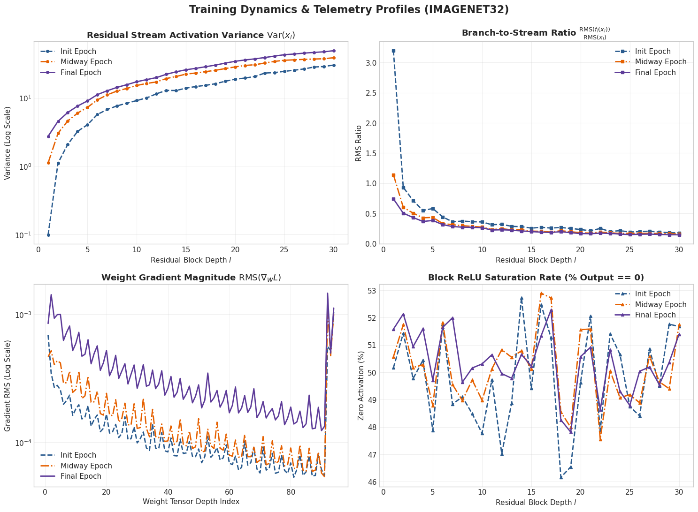
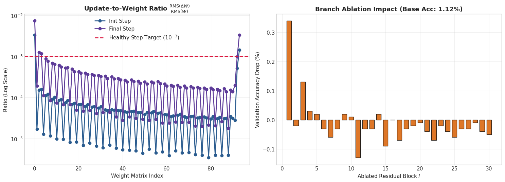
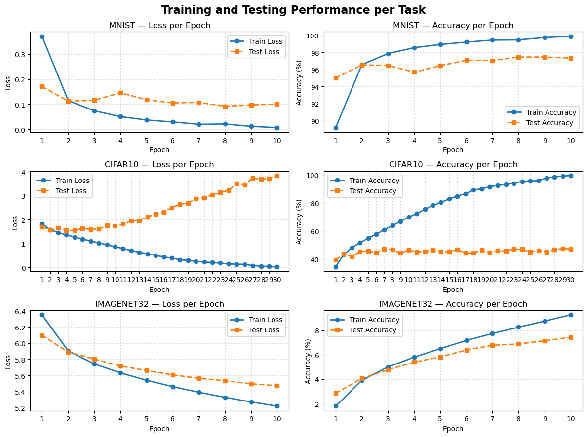

# Final Report - AI5200 Project 1 - Clay Chambers
## Final report
The log records what you did; the report explains what you learned. Submit it as a PDF with these
sections:
### 1. Final models.
For each task, describe your final architecture and training recipe: depth, width, activation, normalization, optimizer, schedule, regularization, augmentation, and training time. A table works well here. Report test accuracy from the harness next to the baseline's.

### 2. What mattered most.
Which three to five changes improved accuracy the most? Support each claim with entries from your log that show the change and its effect.

### 3. Training dynamics.
Your ImageNet analysis from the section above: the figures and what they show about how your model trains. In the 5000-level section, this includes your ablation study.

### 4. What did not work.
Describe ideas that failed and your best explanation of why.

### 5. Across the three tasks.
How and why do your final models differ between MNIST, CIFAR-10, and ImageNet 32×32? What does that tell you about the limits of MLPs on images?

### 6. Explanations of anything beyond the basics.
For each technique not covered in class, explain how it works and why you used it

# Training Dynamics Analysis #

## Baseline run after adding telemetry and analytics scripts ##
* Running imagenet32 with 60,000 test images.
* commit 05b7b6d29a
* Model: ResidualMLP - linear -> ReLU -> linear. output activation: sigmoid
    * Width: 128
    * Hidden: 256
    * Depth: 30
* Training Regimen
    * Epochs: 5
    * batch size: 256
    * learning rate: 0.05
    * optimizer momentum: 0.9
* Accuracy: 1.12%

### Notes ###
First run after adding telemetry script. Just used 60K images for starters.

I see the residual stream growing at the expected rate as a function of depth.

Branch to stream ratio decreases and gets close to zero in later layers.

## Discovered Overfitting

### Observations after change 13, commit #203d56f8

In change 13, I finally added capability to monitor and plot accuracy and loss
curves. I had already suspected overfitting based on some previous outputs from
my mnist model where loss shrank near zero but test accuracy didn't budge. But I
was very surprised to discover the extent of overfitting, especially in the
cifar10 model. After 30 epochs with a SwiGLU network depth 30, my training loss
shrank to 0.02, and training accuracy was over 99%. But test accuracy was still
a measly 47% and had barely improved since epoch 2. That's a textbook example of
overfitting.

    ============================================================
    ======================= TASK: MNIST ========================
    ============================================================
    Epoch-by-Epoch Results for MNIST
        Train Loss	Train Acc (%)	Test Loss	Test Acc (%)
    Epoch 1	0.3712	89.17%	0.1709	95.01%
    Epoch 2	0.1146	96.56%	0.1124	96.52%
    Epoch 3	0.0736	97.86%	0.1157	96.47%
    Epoch 4	0.0506	98.54%	0.1460	95.68%
    Epoch 5	0.0370	98.92%	0.1178	96.43%
    Epoch 6	0.0293	99.20%	0.1054	97.07%
    Epoch 7	0.0199	99.44%	0.1074	97.04%
    Epoch 8	0.0211	99.46%	0.0916	97.45%
    Epoch 9	0.0117	99.74%	0.0970	97.45%
    Epoch 10	0.0065	99.88%	0.1008	97.32%
    Summary Highlights:
    • Best Test Accuracy : 97.45% (Epoch 8)
    • Lowest Test Loss   : 0.0916
    • Final Train Accuracy: 99.88%
    • Final Test Accuracy : 97.32%

    ============================================================
    ====================== TASK: CIFAR10 =======================
    ============================================================
    Epoch-by-Epoch Results for CIFAR10
        Train Loss	Train Acc (%)	Test Loss	Test Acc (%)
    Epoch 1	1.8286	34.39%	1.6942	39.31%
    Epoch 2	1.5800	43.20%	1.5682	43.72%
    Epoch 3	1.4535	48.22%	1.6574	41.80%
    Epoch 4	1.3572	51.64%	1.5434	45.41%
    Epoch 5	1.2684	54.75%	1.5485	45.60%
    Epoch 6	1.1851	57.74%	1.6415	44.57%
    Epoch 7	1.1039	60.93%	1.5877	47.23%
    Epoch 8	1.0230	63.83%	1.6101	46.62%
    Epoch 9	0.9455	66.79%	1.7496	44.11%
    Epoch 10	0.8628	69.85%	1.7388	46.35%
    Epoch 11	0.7880	72.40%	1.8127	45.08%
    Epoch 12	0.7041	75.45%	1.9517	45.42%
    Epoch 13	0.6310	78.21%	1.9600	46.26%
    Epoch 14	0.5696	80.36%	2.1125	45.33%
    Epoch 15	0.5010	82.83%	2.2307	45.19%
    Epoch 16	0.4377	84.85%	2.3099	46.69%
    Epoch 17	0.3862	86.54%	2.5077	44.20%
    Epoch 18	0.3212	89.16%	2.6390	44.29%
    Epoch 19	0.2919	90.09%	2.6966	46.33%
    Epoch 20	0.2527	91.47%	2.8743	44.59%
    Epoch 21	0.2223	92.51%	2.9188	45.92%
    Epoch 22	0.2011	93.11%	3.0310	45.64%
    Epoch 23	0.1781	93.98%	3.1315	47.04%
    Epoch 24	0.1426	95.36%	3.2304	46.95%
    Epoch 25	0.1316	95.64%	3.5160	44.92%
    Epoch 26	0.1270	95.80%	3.4529	46.20%
    Epoch 27	0.0735	97.79%	3.7397	44.93%
    Epoch 28	0.0505	98.53%	3.6893	46.57%
    Epoch 29	0.0336	99.12%	3.7214	47.41%
    Epoch 30	0.0202	99.47%	3.8441	47.13%
    Summary Highlights:
    • Best Test Accuracy : 47.41% (Epoch 29)
    • Lowest Test Loss   : 1.5434
    • Final Train Accuracy: 99.47%
    • Final Test Accuracy : 47.13%

    ============================================================
    ===================== TASK: IMAGENET32 =====================
    ============================================================
    Epoch-by-Epoch Results for IMAGENET32
        Train Loss	Train Acc (%)	Test Loss	Test Acc (%)
    Epoch 1	6.3518	1.80%	6.0979	2.87%
    Epoch 2	5.9042	3.92%	5.8896	4.07%
    Epoch 3	5.7427	5.01%	5.8040	4.78%
    Epoch 4	5.6320	5.81%	5.7160	5.40%
    Epoch 5	5.5407	6.51%	5.6616	5.83%
    Epoch 6	5.4613	7.18%	5.6067	6.39%
    Epoch 7	5.3913	7.75%	5.5636	6.78%
    Epoch 8	5.3288	8.26%	5.5346	6.89%
    Epoch 9	5.2719	8.76%	5.4965	7.16%
    Epoch 10	5.2191	9.27%	5.4727	7.44%
    Summary Highlights:
    • Best Test Accuracy : 7.44% (Epoch 10)
    • Lowest Test Loss   : 5.4727
    • Final Train Accuracy: 9.27%
    • Final Test Accuracy : 7.44%
